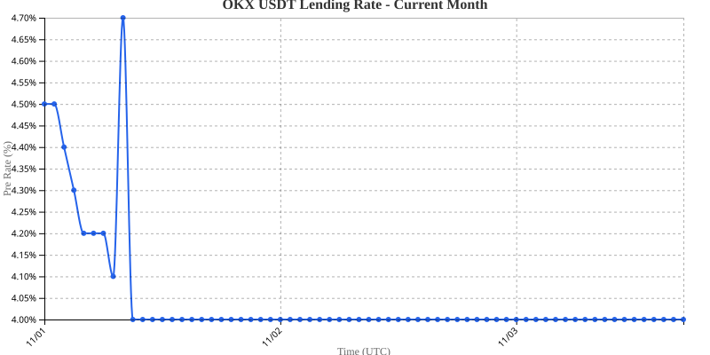

# OKX Lending Rate Monitor

Automated monitoring and visualization of OKX USDT lending rates using TypeScript and GitHub Actions.



## Overview

This project fetches USDT lending rate data from the OKX API every hour and generates visual charts to track rate changes over time. The chart above shows the last 30 days.

## Features

- **Automated Data Collection**: Fetches lending rates from OKX API hourly at 5 minutes past each hour
- **Rolling CSV Store**: `data/rates.csv` keeps the last 40 days of hourly rates; each run fetches only the missing hours
- **Monthly Archives**: Each finished month is saved to `data/YYYY-MM.csv` with its own chart `output/YYYY-MM.svg`
- **Chart Generation**: Creates SVG line charts showing rate trends
- **GitHub Actions Integration**: Fully automated execution and data persistence
- **Gap Filling**: Missing hours anywhere in the window are refetched; one row per UTC hour

## Project Structure

```
okx-lending-rate/
├── src/
│   ├── fetchRate.ts        # Data collection script
│   └── renderRateImage.ts  # Chart generation script
├── data/
│   ├── rates.csv          # Rolling window: last 40 days, hourly
│   └── YYYY-MM.csv        # Archived finished months
├── output/
│   ├── rates.svg          # Last 30 days chart (shown above)
│   └── YYYY-MM.svg        # Per-month archive charts
├── .github/workflows/
│   └── fetch-rate.yml     # GitHub Actions workflow
└── package.json
```

## Scripts

- `npm run fetch` - Fetch missing hours into `data/rates.csv`, archive finished months, prune rows older than 40 days
- `npm run render` - Draw `output/rates.svg` (last 30 days) from `data/rates.csv` and monthly charts from archives (existing monthly SVGs are kept)
- `npm run dev` - Run both fetch and render scripts

## Data Format

The CSV file contains:
- `timestamp`: UTC ISO-8601 timestamp
- `preRate`: Previous lending rate as decimal (e.g., 0.05 = 5%)

## API Endpoint

Data is fetched from: `https://www.okx.com/api/v5/finance/savings/lending-rate-history?ccy=USDT` (hourly history, queried in 24h chunks with `after`/`before` cursors)

## GitHub Actions

The workflow runs automatically every hour at 5 minutes past the hour (0:05, 1:05, etc.) and:
1. Fetches the hours missing from the rolling window (normally just the latest one)
2. Regenerates the charts
3. Commits changes back to the repository

## Local Development

1. Install dependencies:
   ```bash
   npm install
   ```

2. Test data fetching:
   ```bash
   npm run fetch
   ```

3. Generate chart:
   ```bash
   npm run render
   ```

## Requirements

- Node.js 18+
- TypeScript
- Dependencies: csv-writer, csv-parser, d3, jsdom

## Output

- **CSV Data**: `data/rates.csv` (last 40 days) and `data/YYYY-MM.csv` (finished months)
- **SVG Charts**: `output/rates.svg` (last 30 days) and `output/YYYY-MM.svg` (per month)
